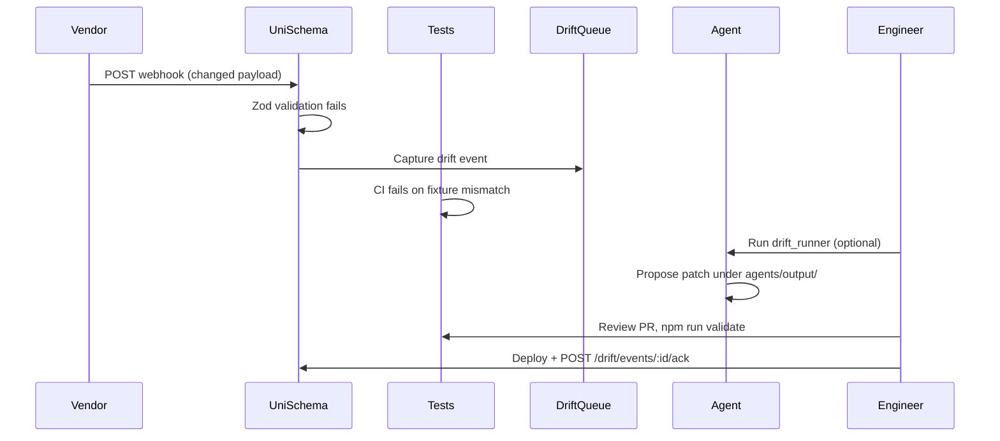

# AI agent loop

UniSchema is designed for **test-driven, human-reviewed** mapper maintenance — not autonomous production self-healing.

## Intended loop

## What is automated

| Step | Automated? |
|------|------------|
| Webhook accept + async ingest | Yes |
| Zod validation failure → drift queue | Yes |
| Vitest CI on every PR | Yes |
| LLM proposes mapper patch | Partial (experimental) |
| Auto-deploy to production | **No** |
| Auto-merge agent PRs | **No** |

## Components

| Component | Location | Role |
|-----------|----------|------|
| Vitest suite | `tests/unit/mappers.test.ts`, `tests/integration/webhooks.test.ts` | Contract boundary for mapper changes |
| Drift queue | `GET /api/drift/events`, SQLite/Postgres | Stores failed payloads + Zod errors |
| Drift agent | `agents/drift_runner/` | LLM proposes patches (experimental) |
| Drift worker | `scripts/drift-worker.ts` | Polls queue, optional local processing |
| Autogenerated fixtures | `tests/autogenerated/` | Agent-scaffolded tests — human review required |

## Operator workflow

1. Drift event appears after webhook validation failure (`GET /health` → `driftPendingCount`)
2. Engineer inspects drift payload in admin UI or API
3. Optionally run `python -m agents.drift_runner` locally
4. Review `agents/output/` proposal
5. Run `npm run validate`, adjust, open PR
6. After deploy: `POST /drift/events/:id/ack`

`GET /health` also reports `humanAckRate` — the share of captured drift events a human has acknowledged — a human-intervention-frequency style signal for this loop (metric concept from the related work cited below; UniSchema's own telemetry, not a paper benchmark).

Full guide → [agents/README.md](../agents/README.md)

## Drift-loop observability

Treating a schema-drift event as an **incident** (capture = detect, human ack = resolve) lets the
loop report the operational metrics an AIOps pipeline would. `GET /health` and `GET /metrics`
(Prometheus text exposition, scrapeable into Grafana) expose:

| Metric | Meaning |
|--------|---------|
| `humanAckRate` | Share of drift events a human has acknowledged |
| `driftMttrSeconds` | Median seconds from capture to ack — the loop's MTTR |
| `driftDistinctPendingSignatures` | Distinct failure fingerprints among pending events (vs `driftPendingCount`) — the alert-noise floor |
| `driftDetectionRate` | Drift events ÷ total ingestion attempts |
| `driftFalsePositiveRate` | Share of acked events labelled `false_positive` |

Every captured event carries a **signature** (vendor + sorted failing field paths/codes) so a
vendor deploy that fires thousands of identical failures is one incident, not thousands of
alerts. `DRIFT_WEBHOOK_URL` fires an incident webhook (PagerDuty/Slack/Jira/generic) **once per
new signature**, and `POST /drift/events/:id/ack` accepts an optional `resolution`
(`schema_change` | `false_positive` | `spam`) for triage.

These framings (MTTD/MTTR, alert-fatigue reduction, detection/false-alarm rates) follow the
authors' AIOps work, "AI-Driven Observability for Real-Time Incident Management," P. Verma,
S. A. Lalakiya, and R. Bharathan, *2025 IEEE ICRTEECT*, IEEE, 2025, pp. 1–7,
[doi:10.1109/ICRTEECT67512.2025.11448853](https://doi.org/10.1109/ICRTEECT67512.2025.11448853).
UniSchema's detection is deterministic (Zod validation), not the paper's ML anomaly scoring, and
the numbers reported are UniSchema's own telemetry, not paper benchmarks.

## Expectations for AI coding agents

When an autonomous coding agent updates mappers:

- **Must pass** `npm run validate` before merge
- **Must not** weaken Zod schemas to make tests pass without business justification
- **Must not** commit PII in fixtures — redact before `tests/__fixtures__/`
- **Should** add or update tests in `tests/unit/mappers.test.ts` for every mapper change

CI workflow: `.github/workflows/agent-validation.yml`

## What this is not

- Unattended production cron that hot-reloads mappers
- Guaranteed-correct LLM patches
- Replacement for vendor relationship management when APIs change

## Related

- [limitations-and-roadmap.md](./limitations-and-roadmap.md#drift-agent-is-experimental)
- Related reading behind the human-in-the-loop stance above — "Enterprise AI Agents: Secure, Scalable, and Autonomous Intelligence for the Modern Workforce," co-authored work by S. K. Venugopal, S. A. Lalakiya, R. Bharathan, and P. Raja, in *2025 IEEE 11th International Conference on Computing, Engineering and Design (ICCED)*, IEEE, 2025, pp. 1–6, [doi:10.1109/ICCED68324.2025.11324763](https://doi.org/10.1109/ICCED68324.2025.11324763). It studies agentic/multi-agent AI for the workforce with an explicit human-in-the-loop framing (Stanford's Human Agency Scale, a human-intervention-frequency metric, value alignment and governance) — thematically adjacent to the human-reviewed loop described here, not a description or validation of UniSchema's specifics.
